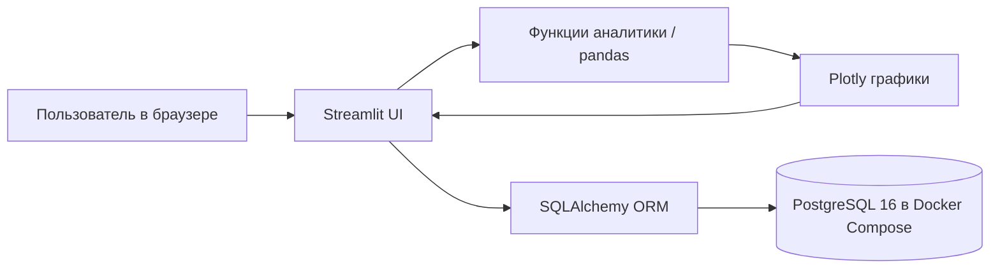

# Архитектура

## Компоненты
- `src/main.py`: формы, фильтры, графики и интерфейс.
- `src/services/database.py`: модель операций и CRUD.
- `src/utils/analytics.py`: агрегирование показателей.
- `tests/`: автоматизированные тесты.

PostgreSQL запускается через Docker Compose, приложение локально через Streamlit.
